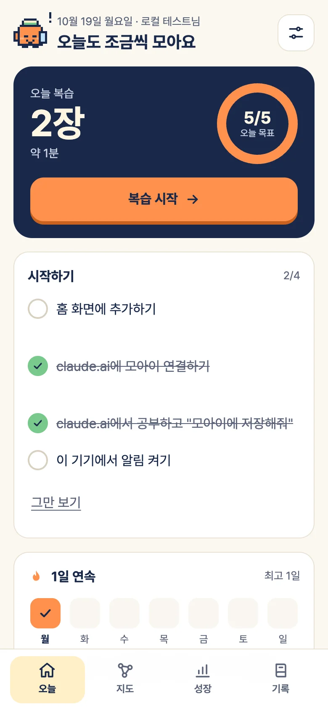
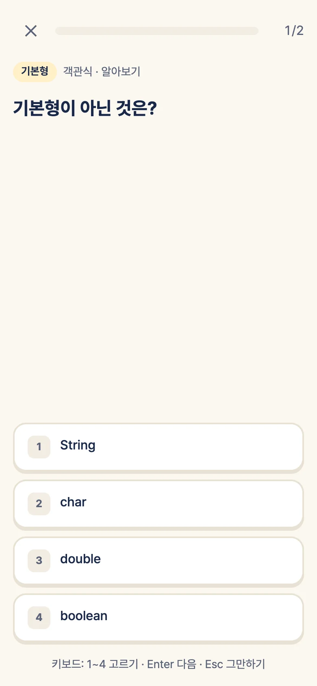
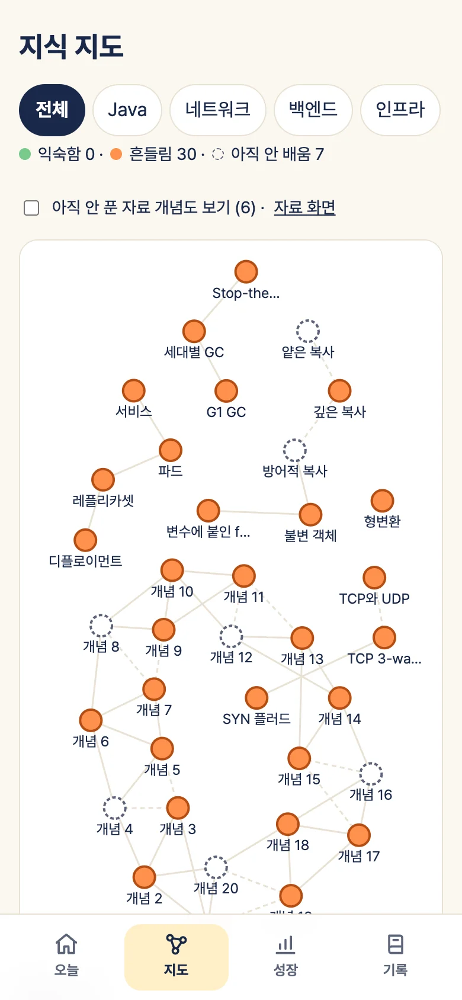

# 모아이 (moAI)

AI와 공부한 대화를 복습 카드와 지식 지도로 바꿔서, 지하철이나 침대에서 2~3분씩 되새기게 하는 서비스예요.

claude.ai나 Claude Code에서 공부하다가 "모아이에 저장해줘"라고 하면, 대화 중인 Claude가 MCP 도구로 개념, 내가 틀린 지점, 복습 카드를 저장해요. 서버가 FSRS로 다음 복습 날짜를 잡고, 휴대폰 홈 화면 앱(PWA)으로 잊을 때쯤 알림을 보내요.

- 서비스: https://moai.smoh.dev
- 스택: Cloudflare Workers(Hono) · D1 · Durable Objects · KV · Cron, React 19 + Vite PWA, MCP 서버, TypeScript

<p>
  
  
  
</p>

## 무엇을 하나요

- **대화에서 카드로**: Claude가 대화를 보고 개념, 판정(맞음·애매·틀림·빠짐), 꼬리질문, 카드(OX·객관식·빈칸·설명하기)를 뽑아 저장해요. 지침 없이 커넥터만 켜면 어느 채팅에서나 돼요.
- **간격 반복**: FSRS로 일정을 잡고, 카드 사다리(알아보기 → 떠올리기 → 설명하기)를 익힌 만큼 열어요. 확신도와 푼 시간으로 등급을 매겨요.
- **오프라인 복습**: 답은 기기에 먼저 쌓고 연결되면 보내요. 자료 섹션은 미리 받아 두면 지하철에서도 풀 수 있어요.
- **지식 지도와 성장**: 개념끼리의 연결, 익힘 상태, 연속 학습, 이정표 배지, 숨은 업적을 보여 줘요.
- **PDF 자료**: Claude Code 플러그인으로 PDF를 장별로 읽어 "자료" 카드로 만들어요. 풀기 전까지는 내 지식과 따로 둬요.
- **서버 AI (선택)**: 설명하기 AI 채점, 개념 물어보기, 모의면접, 붙여 넣은 대화로 카드 만들기. 사람마다 AI 크레딧이 있고, 서비스 전체 월 한도가 있어요.

MCP 도구는 8개예요: `find_concepts`, `save_learning`, `get_learner_context`, `get_review_queue`, `submit_review`, `get_interview_chain`, `get_categories`, `update_categories`. 채팅에서 "복습 퀴즈 내줘", "모의면접 해줘"도 할 수 있어요.

## 모아이 서비스로 쓰기

https://moai.smoh.dev 에서 바로 쓸 수 있어요. 별도 설치나 서버 없이 Claude 구독(Pro 이상, 커넥터를 쓸 수 있는 요금제)만 있으면 돼요.

1. **가입**: 휴대폰 Chrome이나 Safari로 https://moai.smoh.dev 를 열고 **GitHub로 시작하기**를 눌러요. 앱에서 불릴 이름을 정하면 끝이에요.
   - 받은 초대 코드가 있으면 함께 넣어요. 초대 코드 없이 가입하면 월간 AI 크레딧은 0이고, 숨은 업적을 이루면 크레딧을 받아요. 복습과 저장은 크레딧 없이 다 쓸 수 있어요.
   - 카카오톡 안 브라우저에서는 설치와 알림이 안 돼요. Chrome이나 Safari로 열어 주세요.
2. **홈 화면에 추가**: Android는 메뉴 → 앱 설치, iPhone은 Safari 공유 → 홈 화면에 추가. iPhone은 홈 화면 앱에서만 알림을 받을 수 있어요.
3. **알림 켜기**: 앱 설정 → 알림에서 켜고, 알림 시간을 1~3개 정해요. 그 시각에 복습할 카드가 있을 때만 알림이 와요.
4. **Claude에 연결**
   - **claude.ai**: 설정 → 커넥터 → 사용자 지정 커넥터 추가 → 이름 `모아이`, URL `https://moai.smoh.dev/mcp`. 연결하면 뜨는 창에서 모아이에 로그인하고 **허용**을 눌러요.
     도구 권한은 `update_categories`만 "승인 필요"로 두고 나머지는 "항상 허용"으로 두면 휴대폰에서 매번 누르지 않아도 돼요.
   - **Claude Code**: claude.ai 계정으로 로그인했으면 위 커넥터가 그대로 보여요. 직접 추가하려면 아래처럼 하고 `/mcp`에서 moai를 골라 로그인해요.
     ```bash
     claude mcp add --transport http --scope user moai https://moai.smoh.dev/mcp
     ```
   - **Claude Code 플러그인 (선택)**: `/moai:coach`, `/moai:capture`, `/moai:review`, `/moai:pdf` 명령이 생겨요. 자세한 것은 [plugins/moai](plugins/moai/README.md)에 있어요.
     ```
     /plugin marketplace add seungminoh-dev/ai-study-review
     /plugin install moai@ai-study-review
     ```
5. **공부하고 저장**: Claude와 평소처럼 공부하다가 "모아이에 저장해줘"라고 해요. 앱의 오늘 화면에 복습할 카드가 생겨요.

다른 기기(컴퓨터 등)에서는 같은 GitHub로 로그인하거나, 로그인된 기기의 설정 → 다른 기기에서 로그인으로 만든 10분짜리 코드를 넣어요. 개인정보 처리방침과 이용약관은 서비스의 `/privacy`, `/terms`에 있어요.

## 내 Cloudflare에 직접 배포하기

내 계정에 그대로 올려 혼자 또는 지인과 쓸 수 있어요. 이 레포의 설정값(`moai.smoh.dev`, D1·KV id 등)은 제 운영 환경 것이라 아래에서 내 것으로 바꿔요.

### 준비물

- Cloudflare 계정, **Workers Paid 플랜** (무료 플랜의 요청당 CPU 한도를 넘어요)
- Cloudflare에 연결한 도메인 (없으면 `workers.dev` 주소로도 돼요, 아래 2번)
- Node.js 22.12 이상, npm
- 선택: GitHub OAuth 앱 또는 Google OAuth 클라이언트(다른 기기 로그인·가입용), Anthropic API 키(서버 AI용)

### 1. 받기와 설치

```bash
git clone https://github.com/seungminoh-dev/ai-study-review.git
cd ai-study-review
npm ci
cd apps/worker
npx wrangler login
```

`wrangler` 명령은 모두 `apps/worker`에서 실행해요.

### 2. Cloudflare 자원 만들기와 설정 바꾸기

```bash
npx wrangler d1 create moai                    # 나온 database_id를 적어 둔다
npx wrangler kv namespace create OAUTH_KV      # 나온 id를 적어 둔다
node ../../scripts/gen-vapid.mjs               # 알림용 VAPID 키 한 쌍
```

`apps/worker/wrangler.jsonc`에서 다음을 바꿔요.

| 항목 | 바꿀 값 |
|---|---|
| `routes[0].pattern` | 내 도메인 (예: `review.example.com`). 도메인이 없으면 `routes`를 지우고 `workers_dev`를 `true`로 |
| `d1_databases[0].database_id` | 위에서 만든 D1 id |
| `kv_namespaces[0].id` | 위에서 만든 KV id |
| `vars.APP_ORIGIN` | `https://내도메인` (workers.dev면 `https://moai.<계정>.workers.dev`) |
| `vars.VAPID_PUBLIC_KEY` | `gen-vapid`가 출력한 공개 키 |
| `vars.VAPID_SUBJECT` | `https://내도메인` 또는 `mailto:내메일` |

화면에 들어간 제 서비스 정보도 내 것으로 바꿔요: `apps/web/index.html`의 링크 미리보기 주소(`og:url`, `og:image`), `apps/web/src/screens/Legal.tsx`의 문의처와 처리방침 문구.

### 3. 비밀값 넣기

값은 `wrangler secret put`이 물어볼 때 붙여 넣어요. 레포나 로그에 남기지 않아요.

```bash
node ../../scripts/gen-token.mjs               # 출력값 → TOKEN_PEPPER
node ../../scripts/gen-token.mjs               # 출력값 → BOOTSTRAP_CODE (4번에서 한 번 쓴다)
npx wrangler secret put TOKEN_PEPPER
npx wrangler secret put BOOTSTRAP_CODE
npx wrangler secret put VAPID_PRIVATE_KEY      # gen-vapid가 출력한 개인 키
```

| 비밀값 | 필수 | 하는 일 |
|---|---|---|
| `TOKEN_PEPPER` | 필수 | 세션·커넥터 토큰을 해시하는 키. 바꾸면 모든 로그인이 풀려요 |
| `BOOTSTRAP_CODE` | 필수 | 오너 계정을 처음 한 번 만들 때만 써요 |
| `VAPID_PRIVATE_KEY` | 필수 | 웹 푸시 서명 키 |
| `GITHUB_CLIENT_ID`, `GITHUB_CLIENT_SECRET` | 선택 | GitHub 로그인·가입. 콜백 주소는 `https://내도메인/api/auth/github/callback` |
| `GOOGLE_CLIENT_ID`, `GOOGLE_CLIENT_SECRET` | 선택 | Google 로그인·가입 (scope `openid`만). 리디렉션 URI는 `https://내도메인/api/auth/google/callback` |
| `ANTHROPIC_API_KEY`, `GRADER_MODEL` | 선택 | 서버 AI. 둘 다 있어야 켜져요. 서비스 전체 월 한도는 `vars.LLM_MONTHLY_CAP_USD`(기본 90달러) |

로그인 방법을 넣지 않으면 그 버튼은 화면에 나오지 않아요. 그래도 오너는 다른 기기 로그인 코드로 여러 기기를 쓸 수 있어요.

### 4. 마이그레이션, 빌드, 배포

```bash
npx wrangler d1 migrations apply moai --remote
cd ../.. && npm run build && cd apps/worker   # PWA를 apps/web/dist로 빌드
npx wrangler deploy
```

배포한 주소를 휴대폰에서 열면 처음 한 번 **설정 화면**이 나와요. `BOOTSTRAP_CODE`와 이름을 넣으면 오너 계정이 생기고, 그 뒤로 설정 화면은 닫혀요. 그다음은 위 "모아이 서비스로 쓰기"와 같아요. 주소만 `https://내도메인/mcp`로 바꿔서 Claude에 연결하면 돼요.

### 5. GitHub Actions로 자동 배포 (선택)

포크한 레포의 Settings → Secrets에 `CLOUDFLARE_API_TOKEN`(Workers·D1 편집 권한), `CLOUDFLARE_ACCOUNT_ID`를 넣으면 `main`에 머지할 때마다 [Deploy](.github/workflows/deploy.yml)가 타입 검사 → 빌드 → 테스트 → D1 마이그레이션 → 배포 → 운영 확인을 해요. [Health](.github/workflows/health.yml)는 제 서비스 주소를 3시간마다 확인하니, 포크했다면 주소를 바꾸거나 꺼 주세요.

## 로컬 개발

```bash
npm ci
cp apps/worker/.dev.vars.example apps/worker/.dev.vars   # npm run gen:token, npm run gen:vapid로 값 채우기
npm run db:migrate:local
npm run build        # PWA를 apps/web/dist로 빌드
npm run dev          # http://localhost:8787 (Worker가 PWA와 API를 함께 제공)
```

- 화면만 고칠 때는 `npm run dev:web`(Vite, http://localhost:5173)을 함께 띄워요. `/api`와 `/mcp`는 8787로 넘겨요.
- 검사: `npm run typecheck && npm run build && npm test` (Worker 테스트가 빌드한 PWA를 읽어서 빌드가 먼저예요)

## 구조

```
apps/worker      Cloudflare Worker: MCP 서버, REST API, OAuth(커넥터 허용), 매분 Cron(알림·AI 작업), D1 마이그레이션
apps/web         PWA (React + Vite). 빌드 결과 apps/web/dist를 Worker가 정적 파일로 제공
packages/shared  zod 스키마와 규칙 (save_learning 입력, API 요청, 채점, 크레딧)
plugins/moai     Claude Code 플러그인 (코칭, 저장, 복습, PDF)
scripts          키 생성, 아이콘·스크린샷 생성, 테스트 견본 생성
docs             기획서, 설계서, 운영 가이드, 인수인계, ADR
```

## 문서

- [기획서](docs/service-plan.md): 왜 만들었는지, 누구를 위한 것인지
- [설계서](docs/design.md): MVP별 계획, 데이터 모델, API, 보안
- [운영 가이드](docs/runbook.md): 배포, 버전과 PR, 백업·되돌리기, 비밀값 교체
- [인수인계](docs/handoff.md): 지금 상태와 작업 규칙
- [ADR 0001](docs/adr/0001-runtime.md): Cloudflare Worker 하나로 가기로 한 결정
